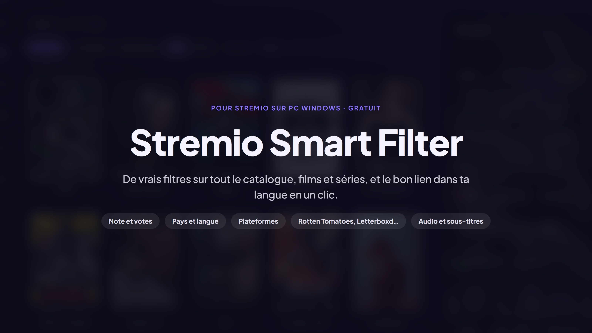
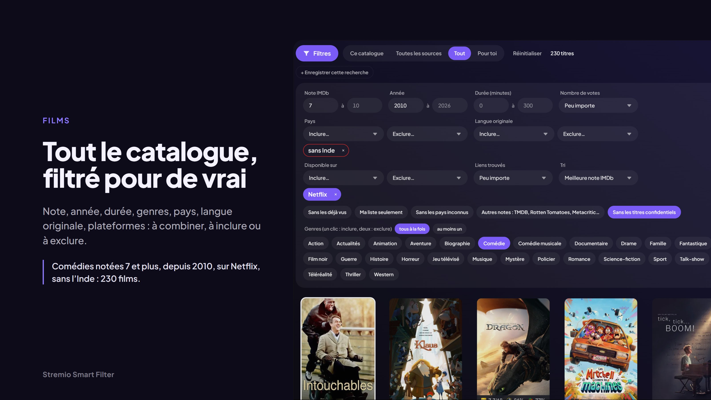
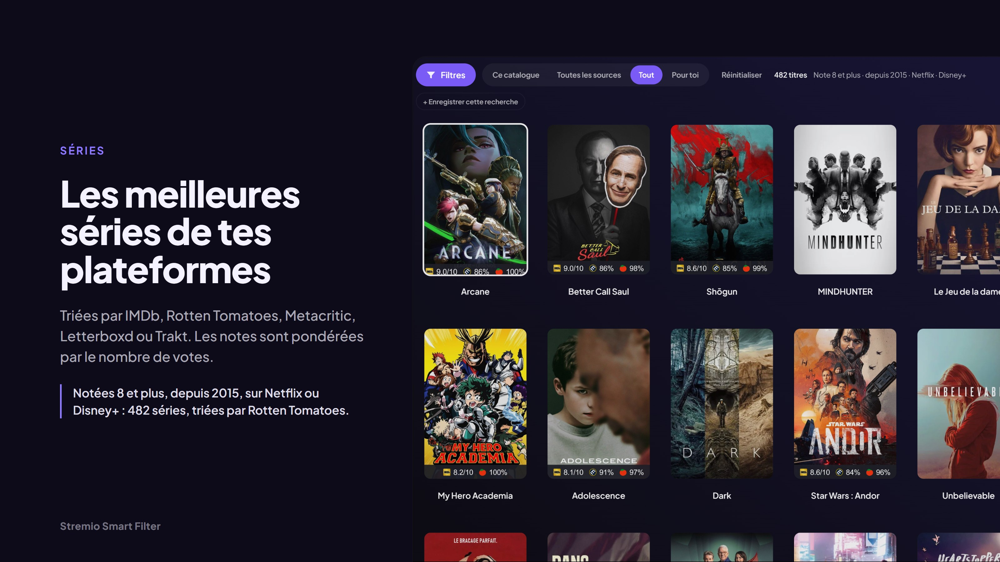
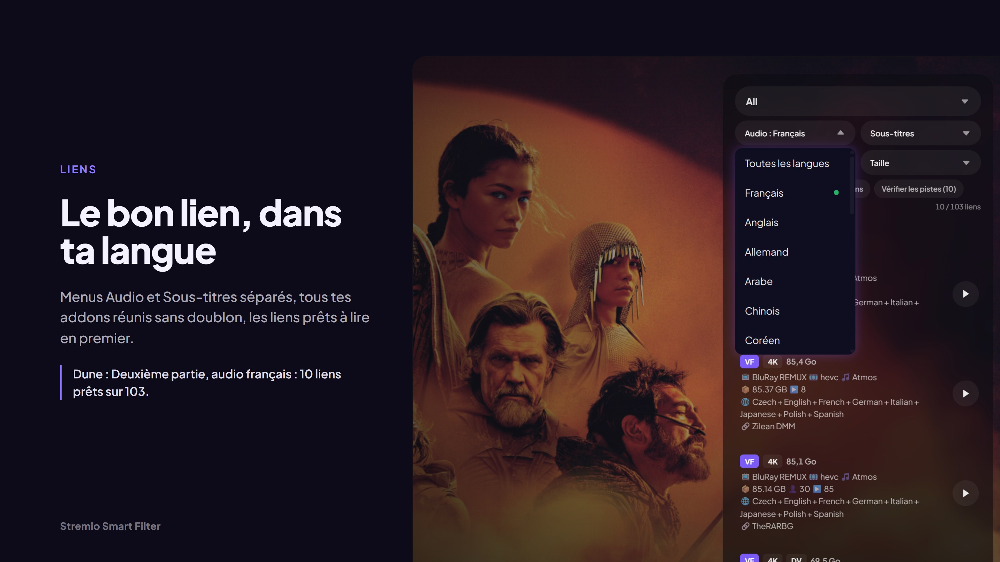

# Stremio Smart Filter

De vrais filtres pour Stremio sur PC Windows : trouver un film ou une série en combinant note, année, pays, langue, plateforme et genres, puis choisir en un clic un lien qui se lit bien en français.

Stremio Smart Filter s'ajoute à ton Stremio habituel : même compte, mêmes addons, même lecteur. Il ajoute un panneau de filtres dans Découvrir et un choix des liens par langue sur la fiche de chaque titre.



> Projet personnel, gratuit, **non affilié à Stremio**. Il ne fournit aucun lien ni aucun addon de liens : il trie et filtre ce que tes propres addons proposent.

## Ce qu'il ajoute



**Dans Découvrir, un bouton « Filtres » :**
- Quatre sources : **Ce catalogue** (n'importe quel addon), **Toutes les sources** (tous les catalogues de tes addons, sans doublon), **Tout** (environ 550 000 titres IMDb, plus ceux de TMDB et de tes addons), **Pour toi** (recommandations tirées de ta bibliothèque).
- Note IMDb, année, durée, nombre de votes, genres (inclure ou exclure).
- Pays et langues d'origine, plateformes françaises (abonnement ou gratuit) : plusieurs à la fois, à inclure ou à exclure (« sans l'Inde », « seulement France et Belgique »).
- Notes d'autres sites : Rotten Tomatoes, Metacritic, Letterboxd, Trakt, TMDB, et leur moyenne.
- Sans les déjà vus, ma liste seulement, sans les titres confidentiels.
- Tris par note, par note d'un autre site, par popularité ou par date. Les notes sont pondérées par le nombre de votes : un 10/10 sur 12 votes ne passe pas devant.
- Recherches enregistrées : chacune devient une rangée de l'accueil.



**Partout :**
- Recherche par titre français ou original, sans se soucier des accents (« les evades », « plan coeur »).
- Aperçu dans la langue de ton Stremio : résumé, casting, notes, plateformes et bande-annonce, avec une pastille par langue disponible (FR, VOSTFR, EN…) à côté du bouton.

**Sur la fiche d'un titre, le choix du lien :**
- Menus **Audio** et **Sous-titres** séparés, plus **Qualité** et **Taille**.
- Tous tes addons réunis, sans doublon ; les liens prêts à lire d'abord.
- Langue déduite du nom du lien, avec des règles vérifiées sur de vrais fichiers.



## Ce qu'il faut

- Windows 10 ou 11, 64 bits.
- **Stremio 5** déjà installé : [stremio.com/downloads](https://www.stremio.com/downloads).
- Un compte Stremio avec tes addons habituels.
- Une **clé TMDB**, gratuite (voir plus bas). Une clé MDBList, gratuite aussi, est facultative.
- Environ 1 Go d'espace disque.

## Installation

1. Télécharge `StremioSmartFilter-Setup-<version>.exe` dans les [Releases](../../releases/latest).
2. Lance-le. Si Windows affiche « Windows a protégé votre ordinateur », voir [SmartScreen](#windows-smartscreen) juste en dessous.
3. Colle ta clé TMDB (et ta clé MDBList si tu en as une). L'installeur vérifie la clé TMDB.
4. L'installeur télécharge les données (environ 100 Mo), puis la liste des titres IMDb (environ 230 Mo), et prépare tout : compte quelques minutes.
5. Lance **Stremio Smart Filter** avec le raccourci du Bureau.
6. Au premier lancement, connecte-toi à ton compte Stremio dans la fenêtre qui s'ouvre. Elle ne partage pas la session de l'application Stremio habituelle ; tes addons et ta bibliothèque reviennent dès la connexion.

L'icône Stremio habituelle continue d'ouvrir Stremio tel quel. Le raccourci « Stremio Smart Filter » ouvre Stremio avec les filtres.

## Windows SmartScreen

L'installeur n'est pas signé (un certificat de signature coûte plusieurs centaines d'euros par an). Au premier lancement, Windows peut afficher :

> Windows a protégé votre ordinateur

Clique sur **Informations complémentaires**, puis sur **Exécuter quand même**.

Pour vérifier que le fichier est bien celui publié ici, compare son empreinte avec celle donnée dans la Release :

```powershell
Get-FileHash .\StremioSmartFilter-Setup-<version>.exe -Algorithm SHA256
```

## Obtenir les clés

**TMDB (obligatoire, gratuit).** Il fournit les titres français, les pays, les langues, les plateformes et les bandes-annonces.
1. Crée un compte sur [themoviedb.org](https://www.themoviedb.org/signup).
2. Va dans [Paramètres > API](https://www.themoviedb.org/settings/api) et demande une clé (usage personnel).
3. Copie la « Clé d'API » (ou le « Jeton d'accès en lecture à l'API » : les deux marchent).

**MDBList (facultatif, gratuit).** Il ajoute les notes Rotten Tomatoes, Metacritic, Letterboxd et Trakt.
1. Connecte-toi sur [mdblist.com](https://mdblist.com).
2. Va dans [Preferences](https://mdblist.com/preferences/), rubrique API key, et copie la clé.

Sans clé MDBList, ces notes restent celles du paquet de données téléchargé à l'installation.

## Mises à jour

- **Données** : à chaque lancement, le raccourci relance en arrière-plan ce qui a plus de 7 jours (nouveaux titres IMDb, fiches TMDB, catalogues de tes addons, notes). Rien à faire.
- **Application** : télécharge et lance la nouvelle version de l'installeur. Tes clés et tes données sont gardées.

## Désinstaller

Paramètres Windows > Applications > **Stremio Smart Filter** > Désinstaller. Tout le dossier de l'application est supprimé (données et clés comprises). Stremio et ton compte ne sont pas touchés.

## Ce qui se passe sur ton PC

- Tout tourne sur ton PC : un petit serveur local (`127.0.0.1:11480`) sert l'interface et les filtres. Il n'est pas joignable depuis un autre appareil.
- Dossier : `%LOCALAPPDATA%\Programs\Stremio Smart Filter`. Tes clés sont dans le fichier `.env` de ce dossier, et nulle part ailleurs.
- Il contacte : TMDB et MDBList (avec tes clés), IMDb et Wikidata (données publiques), et les addons de ton compte Stremio. Aucune autre adresse, aucune statistique d'usage.
- Le filtre « Liens trouvés » s'appuie sur une vérification faite à la préparation du paquet de données ; elle n'est pas refaite sur ton PC.

## Questions fréquentes

**Ça marche sur Mac, iPad, Android ?** Non, seulement sur Windows : il faut le Stremio de bureau et un PC allumé.

**L'antivirus bloque l'installeur.** Il n'est pas signé (voir SmartScreen). Vérifie l'empreinte SHA-256, puis autorise-le.

**« Stremio 5 n'est pas installé ».** Installe Stremio depuis [stremio.com/downloads](https://www.stremio.com/downloads), lance-le une fois, puis relance l'installeur.

**Une erreur pendant la préparation des données.** Vérifie ta connexion, puis relance l'installeur : il refait la préparation.

## Pour les développeurs

- `engine/` : le moteur, en Python (bibliothèque standard seulement). Tests : `uv run python -m unittest discover -s engine -p "test_*.py" -t .`
- `lancer.ps1`, `moteur.ps1`, `reprendre.ps1`, `chemins.ps1` : le raccourci, le moteur, les mises à jour en arrière-plan.
- `installeur/` : le paquet de données (`paquet.py`), l'installeur Inno Setup (`stremio-smart-filter.iss`) et sa construction (`construire.ps1`).
- L'interface est un fork de [stremio-web](https://github.com/Stremio/stremio-web) : [garybouvet/stremio-web-custom](https://github.com/garybouvet/stremio-web-custom), branche `nouveau-stremio`. `construire.ps1` attend sa version compilée dans `stremio-web/build`.

## Licence et crédits

- Ce dépôt : licence MIT (voir [LICENSE](LICENSE)).
- L'interface est un fork de [stremio-web](https://github.com/Stremio/stremio-web), sous licence GPL-2.0, comme son code source modifié.
- Stremio est une marque de Smart Code. Ce projet n'est ni affilié à Stremio ni approuvé par Stremio.
- Ce produit utilise l'API TMDB mais n'est ni approuvé ni certifié par TMDB.
- Information courtesy of IMDb (https://www.imdb.com). Used with permission.
- Notes d'autres sites fournies par [MDBList](https://mdblist.com) ; pays complétés par [Wikidata](https://www.wikidata.org).
